# MotoRepuestos · REST API + Angular

E-commerce de repuestos para motos. Es la **segunda implementación** del mismo negocio que la versión
[ASP.NET Core MVC](../eCommerceMotoRepuestos) (Razor + SQLite): acá el backend es una **API REST** con
**SQL Server**, y el frontend una **SPA Angular**. La idea es mostrar cómo cambia la arquitectura (y qué
se gana y qué se paga) manteniendo el dominio.

| | MVC (versión 1) | **REST + Angular (esta)** |
|---|---|---|
| UI | Razor + Bootstrap + jQuery | Angular 21 (standalone, signals, zoneless) + Tailwind v4 |
| Backend | Controllers + Services + Repositories | Clean Architecture: Domain / Application / Infrastructure / Api |
| Datos | SQLite (archivo) | SQL Server + EF Core 10 (migraciones, rowversion, índices) |
| Auth | Cookie de sesión | JWT de vida corta + refresh token rotativo en cookie `HttpOnly` |
| Carrito invitado | `Session` del servidor | Carrito persistido con id anónimo (`X-Cart-Id`) + merge al loguearse |
| Concurrencia de stock | Transacción | Concurrencia optimista (`rowversion`) + reintentos |
| Errores | Páginas de error / TempData | RFC 9457 `ProblemDetails` con códigos de error |
| Docs de API | — | OpenAPI + Scalar (`/scalar`) |
| Tests | — | 56 unitarios + 22 de integración (SQL Server real en contenedor) + 29 specs de Angular |

## Capturas

| Tienda | Catálogo | Producto |
|---|---|---|
| 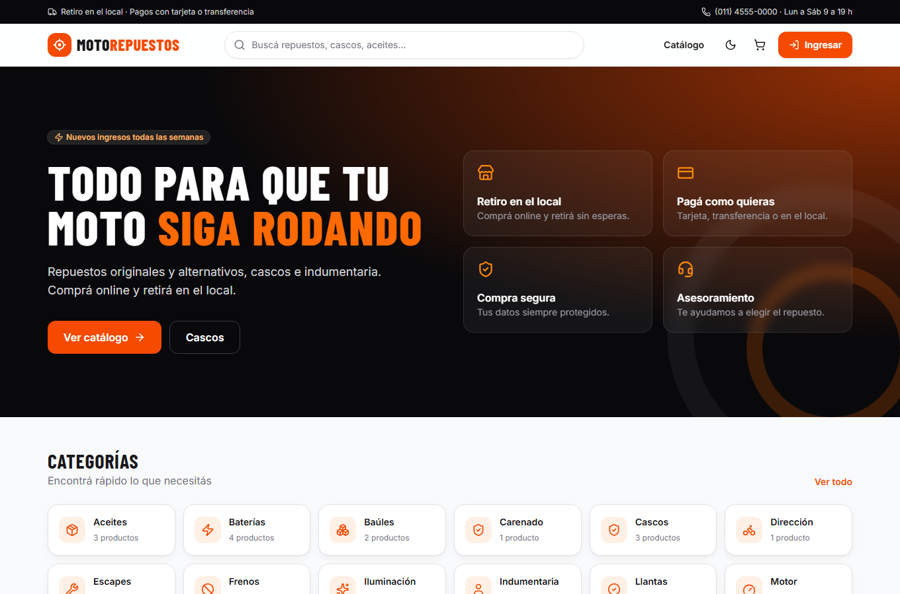 | 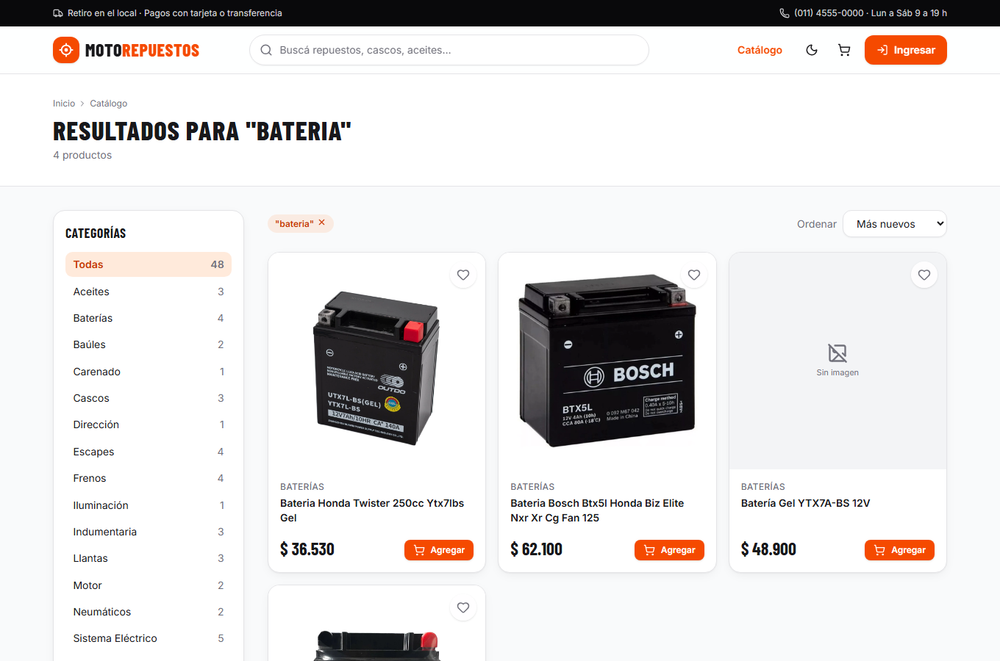 | 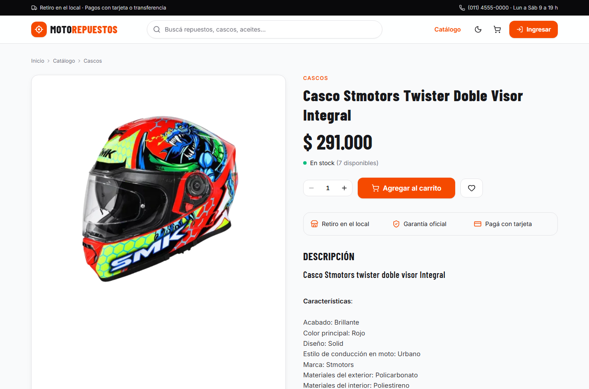 |

| Carrito | Checkout | Seguimiento del pedido |
|---|---|---|
| 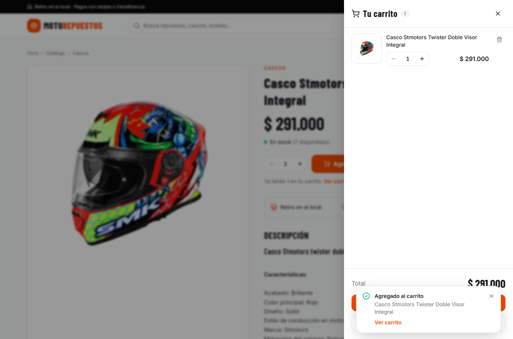 | 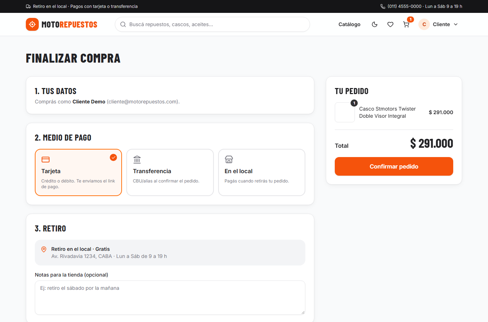 | 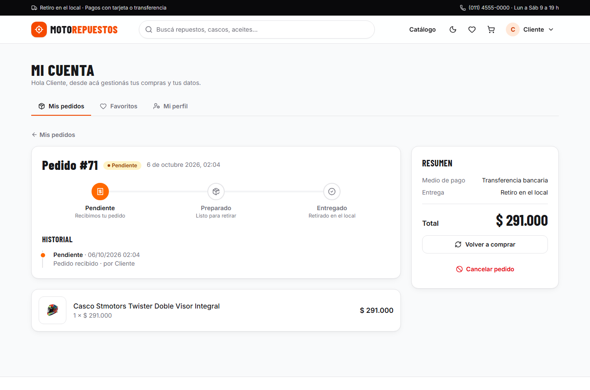 |

| Dashboard (admin) | Gestión de pedidos | Editor de producto |
|---|---|---|
| 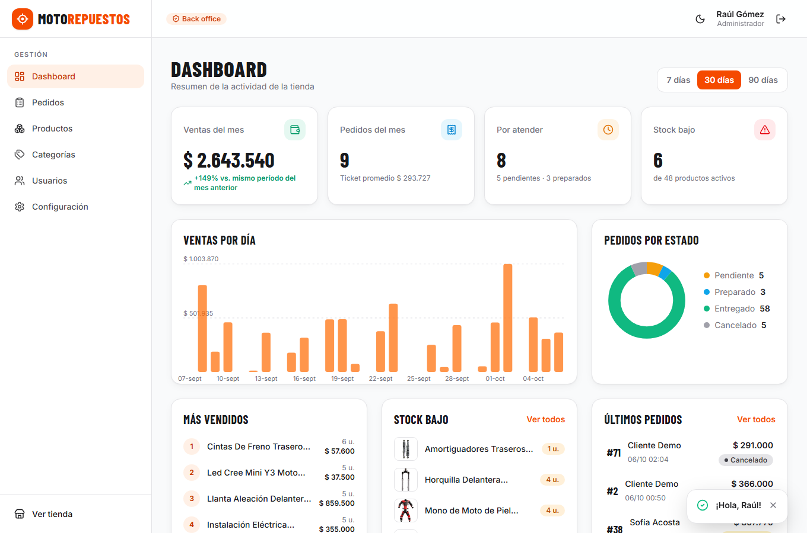 | 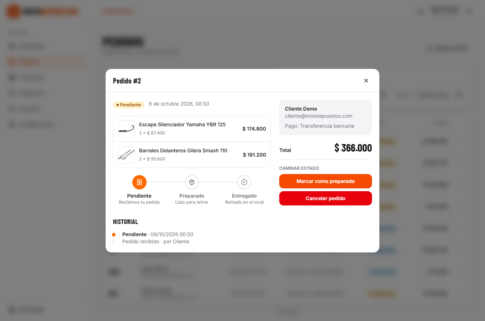 | 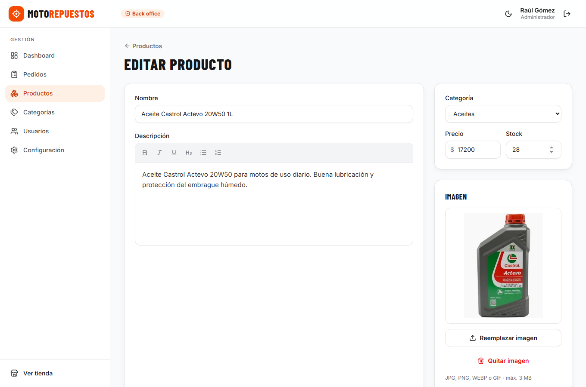 |

| Modo oscuro | Móvil |
|---|---|
| 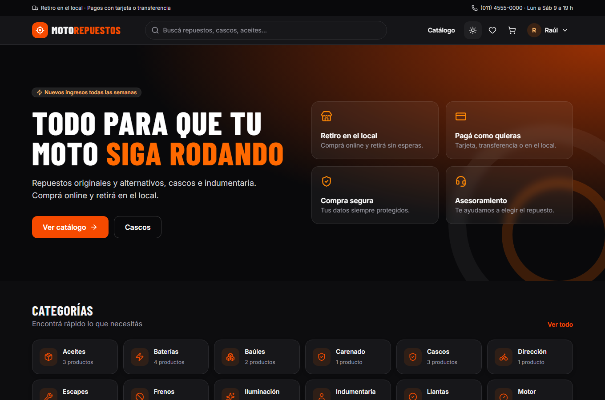 | 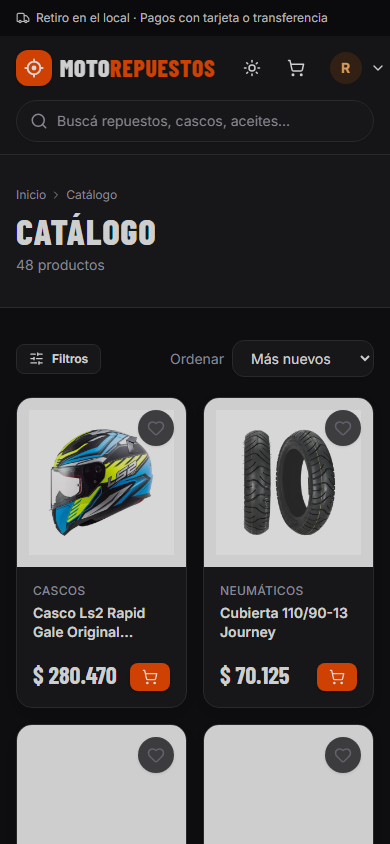 |

## Qué incluye

**Tienda (público)** — catálogo paginado con filtros por categoría/precio/orden (estado en la URL),
búsqueda insensible a mayúsculas y acentos con autocompletado, detalle de producto con relacionados,
carrito (drawer + página), checkout (tarjeta / transferencia / en el local), seguimiento de pedidos con
timeline, favoritos, perfil y cambio de contraseña, modo oscuro, responsive.

**Backoffice (Admin / SuperAdmin)** — dashboard con KPIs, ventas por día, más vendidos y alertas de stock
bajo; ABM de productos con editor de texto enriquecido (sanitizado en el servidor) y subida de imágenes
(valida firma del archivo); categorías con validación asíncrona de nombre; pedidos con filtros, máquina de
estados con historial y **exportación CSV**; usuarios (alta de admins y deshabilitación, solo SuperAdmin);
configuración del umbral de stock bajo; **backups/restore nativos de SQL Server**.

### Features nuevas respecto al MVC
Dashboard · favoritos · cancelación de pedidos por el cliente (con reposición de stock) · historial de
estados · edición rápida de stock · exportación CSV · modo oscuro · cambio de contraseña · deshabilitar
usuarios · ordenar/filtrar catálogo por precio · "volver a comprar" · rate limiting en login/registro.

## Arquitectura

```
┌────────────────────┐   HTTPS/JSON    ┌──────────────────────────────────────────────┐
│  Angular SPA       │ ──────────────▶ │  MotoRepuestos.Api         (controllers, auth)│
│  (nginx en Docker) │ ◀────────────── │  ├─ Application   (casos de uso, DTOs, FV)    │
└────────────────────┘  ProblemDetails │  ├─ Domain        (entidades + reglas)        │
                                       │  └─ Infrastructure (EF Core, JWT, storage)    │
                                       └───────────────────────┬──────────────────────┘
                                                               ▼
                                                         SQL Server 2022
```

- **Domain**: entidades con comportamiento (no anémicas). `Order.Place` descuenta stock y fija precios,
  `Order.ChangeStatus` valida la máquina de estados, `Cart.MergeFrom` limita por stock, etc. Sin dependencias.
- **Application**: un servicio por feature (`OrderService`, `CatalogService`…) que compone consultas LINQ
  directamente sobre `IAppDbContext` (sin repositorios genéricos: EF Core ya es unit of work + repository) y
  devuelve `Result<T>` en lugar de lanzar excepciones para errores esperables. Validación con FluentValidation.
- **Infrastructure**: EF Core + configuraciones `IEntityTypeConfiguration`, interceptor de auditoría
  (`CreatedAt/UpdatedAt`), JWT, `PasswordHasher`, sanitizador HTML, storage de imágenes, backups, seeder.
- **Api**: controllers finos, `GlobalExceptionHandler`, CORS, rate limiting, health checks, OpenAPI.

### Decisiones que vale la pena mirar

1. **Stock sin sobreventa** — `Product.RowVersion` (`rowversion`) + `DbUpdateConcurrencyException` con
   reintentos en `OrderService`. El test `Two_customers_racing_for_the_last_unit_produce_exactly_one_order`
   lanza 6 checkouts simultáneos por la última unidad y verifica que exactamente uno gana.
2. **Sesiones seguras** — access token de 15 min **solo en memoria**; refresh token (7 días) en cookie
   `HttpOnly; SameSite=Strict` limitada a `/api/auth`, guardado hasheado (SHA-256), **rotado en cada uso**;
   si se reutiliza uno ya rotado se revocan todas las sesiones del usuario (detección de robo).
   El interceptor de Angular renueva el token una sola vez aunque fallen varias requests a la vez.
3. **Precios y totales siempre del servidor** — el cliente nunca envía precios; los ítems del pedido guardan
   *snapshot* de nombre/precio, así editar un producto no reescribe el historial.
4. **XSS** — las descripciones son HTML (editor rico): se sanitizan con whitelist en el servidor
   (HtmlSanitizer) y se renderizan con `[innerHTML]` (Angular además sanea). Las imágenes se validan por
   extensión, tamaño y *magic numbers*.
5. **Caché** — `HybridCache` para categorías y configuración, invalidado por tags al modificar el catálogo.
6. **Fechas** — todo se guarda en UTC y se serializa con `Z`; los filtros de "día" usan la zona horaria de
   la tienda (Argentina).
7. **Búsqueda** — columna `SearchText` normalizada (sin acentos/HTML), igual que en el MVC pero calculada en
   el dominio; filtros y paginado se resuelven en SQL.

## Cómo correrlo

### Opción A — Docker (todo junto)
```bash
docker compose up --build
```
Tienda en <http://localhost:8080> · Docs de la API en <http://localhost:8080/scalar>.
Datos de demo: 19 categorías, 48 productos (con imágenes), 8 usuarios y ~70 pedidos históricos.

### Opción B — desarrollo local
Requisitos: .NET 10 SDK, Node 24+, SQL Server (LocalDB, Docker o instancia propia).

```bash
# 1) Base de datos (si no tenés SQL Server local)
docker run -e ACCEPT_EULA=Y -e MSSQL_SA_PASSWORD='Your_strong_Passw0rd!' -p 1433:1433 -d mcr.microsoft.com/mssql/server:2022-latest

# 2) API  → http://localhost:5080  (aplica migraciones y siembra datos al iniciar)
cd backend/src/MotoRepuestos.Api
dotnet user-secrets set "ConnectionStrings:Default" "Server=localhost,1433;Database=MotoRepuestosRest;User Id=sa;Password=Your_strong_Passw0rd!;TrustServerCertificate=True"
dotnet run

# 3) Frontend → http://localhost:4200  (proxy a la API, mismo origen)
cd frontend
npm install
npm start
```
Por defecto la API usa `(localdb)\MSSQLLocalDB` (ver `appsettings.json`).
En desarrollo la cookie de refresh se envía por HTTP porque el proxy de Angular hace que sea *same-origin*;
en producción se sirve todo detrás de HTTPS (`Auth:SecureCookies=true`, valor por defecto).

### Cuentas de demo (contraseña `Demo1234!`)
| Rol | Email |
|---|---|
| Cliente | `cliente@motorepuestos.com` |
| Admin | `admin@motorepuestos.com` |
| Super admin | `superadmin@motorepuestos.com` |

## Tests
```bash
cd backend
dotnet test --project tests/MotoRepuestos.UnitTests          # dominio + validaciones (sin infraestructura)
dotnet test --project tests/MotoRepuestos.IntegrationTests   # API real + SQL Server en Testcontainers (requiere Docker)
cd ../frontend && npx ng test --no-watch                     # Angular (Vitest)
```
Los de integración usan un contenedor descartable; con `TEST_SQL_CONNECTION` se puede apuntar a otro servidor.

## Estructura
```
backend/
  src/
    MotoRepuestos.Domain/          entidades y reglas de negocio
    MotoRepuestos.Application/     casos de uso, DTOs, validadores, Result<T>
    MotoRepuestos.Infrastructure/  EF Core, migraciones, JWT, storage, backups, seed
    MotoRepuestos.Api/             controllers, middleware, OpenAPI
  tests/                           unitarios + integración
frontend/src/app/
  core/       auth, interceptores, stores (carrito/favoritos), clientes de API, modelos
  shared/     componentes UI, pipes, validadores
  layout/     layout de la tienda (header, buscador, drawer del carrito)
  features/   catalog · cart · auth · account · admin   (lazy-loaded)
```

## Siguiente paso
La tercera versión del portfolio lleva este mismo dominio a **microservicios** (RabbitMQ, API Gateway,
base por servicio, sagas) para comparar los tres enfoques.
